# ZAWED database: entity–relationship guide

**Schema version:** 16 (`V1` … `V16` in `apps/api/src/main/resources/db/migration`) · **Database:** PostgreSQL 18 · **Updated:** 2026-11-19 (production hardening)

This guide explains every table, grouped by business area. Each section has a diagram (Mermaid; it renders on GitHub and in VS Code), what the tables are for, and the rules the database itself enforces. The migrations are the source of truth: when this guide and a migration disagree, the migration wins, and the guide should be fixed.

**Contents**
1. Conventions that apply to every table
2. The map: how the areas connect
3. Multi-tenancy: how each customer is kept apart
4. Identity and audit
5. Companies and fleet
6. Station network and devices
7. Fuel prices
8. Ledger, wallets and reconciliation
9. Fuelings, alerts and offline sync
10. Station finance
11. Support tickets
11b. Bulk vehicle import
12. Who can see what (row-level security)
13. How money moves (ledger postings)
14. Migration history

---

## 1. Conventions that apply to every table

| Rule | Detail |
|---|---|
| Keys | `uuid` version 7, created by the application, or by an offline device for `fuelings.client_txn_id`. Time-ordered, so `ORDER BY id` is creation order and lists page by `id < :cursor`. |
| Money | `bigint` **piastres** (1 EGP = 100 piastres). Never `numeric`, `real` or `double`. Columns end in `_piastres`. |
| Volume | `bigint` **millilitres**. Columns end in `_ml`. |
| Time | `timestamptz` holding UTC. Shown in `Africa/Cairo` by the clients. Limit periods use the station's time zone; weeks start on Saturday. |
| Nothing is deleted | "Deleted" is a status (`DEACTIVATED`, `ARCHIVED`, `CLOSED`, `SUPERSEDED`…). Fuelings, ledger entries, audit rows and ticket messages are append-only, and triggers refuse `UPDATE`/`DELETE` on them. |
| Foreign keys | Every FK has an index. Columns named `*_by` (`created_by`, `decided_by`…) hold a user id but are **deliberately not FKs**: an audit or decision row must never be refused because of another table. |
| Audit columns | Most master tables have `created_at`, `created_by`, `updated_at`, `updated_by`. The diagrams leave them out to stay readable. |
| Enumerations | `text` with a `CHECK (… IN (…))`, mirrored by a Java enum. Adding a value means a new migration that drops and re-creates the check. |
| Migrations | Forward only. A mistake is fixed by a new migration, never by editing an applied one. |
| Runtime role | The application connects as the owner but runs every transaction as `zawed_app` (`SET ROLE`). `zawed_app` has only the grants each table needs, and row-level security applies to it (section 11). |

---

## 2. The map: how the areas connect

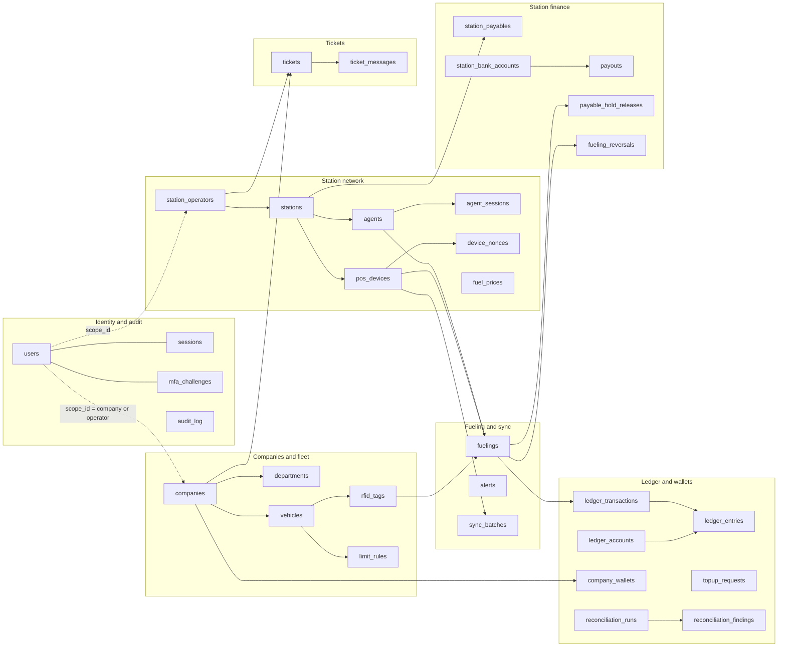

A fueling joins the two sides of the business. **Fleet side:** the company, vehicle and tag. **Station side:** the operator, station, device and agent. A completed fueling posts one ledger transaction that moves money from the company's wallet to the station's payable.

---

## 3. Multi-tenancy: how each customer is kept apart

**The model: one database, one schema, a tenant column on every row, and row-level security.** There is no database or schema per customer. Isolation is enforced by PostgreSQL on every query, and checked again in the API.

| Scope | Who | Tenant column | Sees |
|---|---|---|---|
| `PLATFORM` | Super Admin, Ops | — | everything |
| `COMPANY` | Fleet Manager, Accountant | `company_id` | its own company's rows |
| `OPERATOR` | Station Manager | `operator_id` | its own operator's stations and their rows |

Tables fall into four groups:
- **Company-owned:** `companies`, `departments`, `vehicles`, `rfid_tags`, `limit_rules`, `company_wallets`, `topup_requests`.
- **Operator-owned:** `station_operators`, `stations`, `pos_devices`, `agents`, `agent_sessions`, `station_payables`, `station_bank_accounts`, `payouts`, `sync_batches`.
- **Shared between both sides:** these carry both `company_id` and `operator_id`, and each side sees its own: `fuelings`, `fueling_reversals`, `alerts`. `tickets` carries one or the other.
- **Global:** `fuel_prices`, read by everyone and written by the platform.

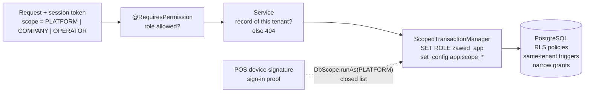

Layers, in the order a request meets them:

1. **The token decides the tenant, never the request.** The scope comes from the signed-in user's session. Endpoints under `/company/**` and `/station/**` take no company or operator id from the URL or the body. A request that names another tenant's record simply does not find it.
2. **Permission.** Each endpoint declares `@RequiresPermission`, and `AuthorizationMatrixTests` checks every endpoint against every role.
3. **Service checks.** Where a record is named by id (a station's statement, for example), the service checks it belongs to the caller (`StationAccess`) and answers **404**, never 403, so another tenant's ids are not even confirmed to exist.
4. **The transaction carries the scope.** `ScopedTransactionManager` starts every transaction with `set_config('app.scope_type' | 'app.scope_id' | 'app.user_id', …, true)`. These settings are transaction-local, so a pooled connection never carries one request's scope into the next. Every connection runs `SET ROLE zawed_app` (`connection-init-sql`), and a transaction running as any other role is refused. A query outside a transaction has no scope and sees no scoped rows: it fails safe.
5. **Row-level security** on every tenant table (V3, V4, V6–V11), using `app_scope_type()`, `app_scope_id()` and `app_is_platform()`. A bug in a query cannot return another tenant's rows.
6. **Same-tenant triggers.** `check_same_tenant` (V4) and `fuelings_same_tenant` (V7_1) refuse a row whose parents belong to different tenants, such as a tag on another company's vehicle or a fueling whose station is not the device's.
7. **Narrow grants.** `zawed_app` has only what each table needs; for example, no `UPDATE` or `DELETE` on `fuelings` or ledger entries.

**The only ways around it** are explicit `DbScope.runAs(PLATFORM)` calls. They happen only after a proof is checked, and only in a closed list that `ArchitectureTests` enforces:
- sign-in: `identity/Sessions`, `identity/SignIn`;
- the POS channel: `network/DeviceChannel`, `network/AgentSessions`;
- fueling: `fueling/FuelingEngine`, `fueling/Receipts`;
- offline: `fueling/OfflineSync`, `sync/Snapshots`.

Adding a file to that list needs a review.

**Tests that prove it:** `RowLevelSecurityTests`, `MasterDataIsolationTests`, `LedgerIsolationTests`, `AuthorizationMatrixTests`, `ArchitectureTests`, plus cross-tenant cases in `StationFinanceTests` and `TicketsTests`.

**Checklist for a new table that holds tenant data:**
1. A `company_id` and/or `operator_id` column, with an index.
2. `ENABLE ROW LEVEL SECURITY`, and a policy for each scope that reads it.
3. Grants to `zawed_app` for only what is needed.
4. A same-tenant trigger if it has a parent in a tenant.
5. Rows in `AuthorizationMatrixTests`, and an isolation test that one tenant cannot read another's rows.

---

## 4. Identity and audit (`V2`, `V3`; module `identity`, `audit`)

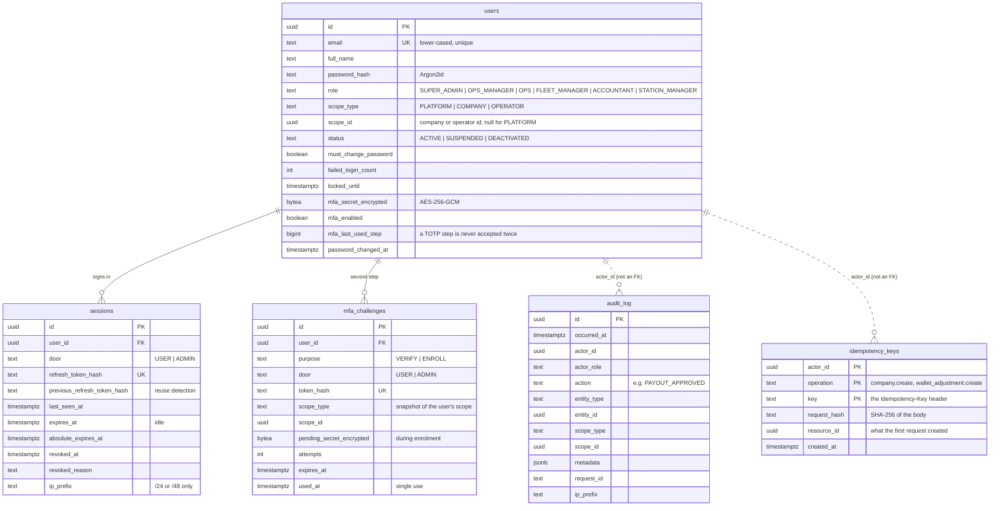

- **The role decides the scope** (a CHECK): Super Admin, Ops Manager (V12) and Ops are `PLATFORM`; Fleet Manager and Accountant are `COMPANY` (`scope_id` = a company); Station Manager is `OPERATOR` (`scope_id` = a station operator). Station **agents** and **drivers** are not users: agents live in `agents` (section 5), and drivers do not exist yet.
- **MFA** is required for Super Admin, Ops and, since B6, Station Manager.
- **Sessions** are checked on every request. A refresh token is rotated on each use, and reusing an old one revokes the session.
- **`audit_log`** is written in the same transaction as the change it records, and is never updated or deleted.
- **`idempotency_keys`** (V13, ADR 0022): a create sent with an `Idempotency-Key` records the key, the body's hash and the resource, in the create's own transaction. A repeat with the same body returns the same resource; with another body it is refused. Each user sees only their own keys (RLS).
- **Security-definer functions** in `V3` (`auth_login_lookup`, `auth_session_by_id`, …) let sign-in read a user before any scope exists. They are the only way around row-level security for identity.

---

## 5. Companies and fleet (`V4`; module `tenancy`, `fleet`)

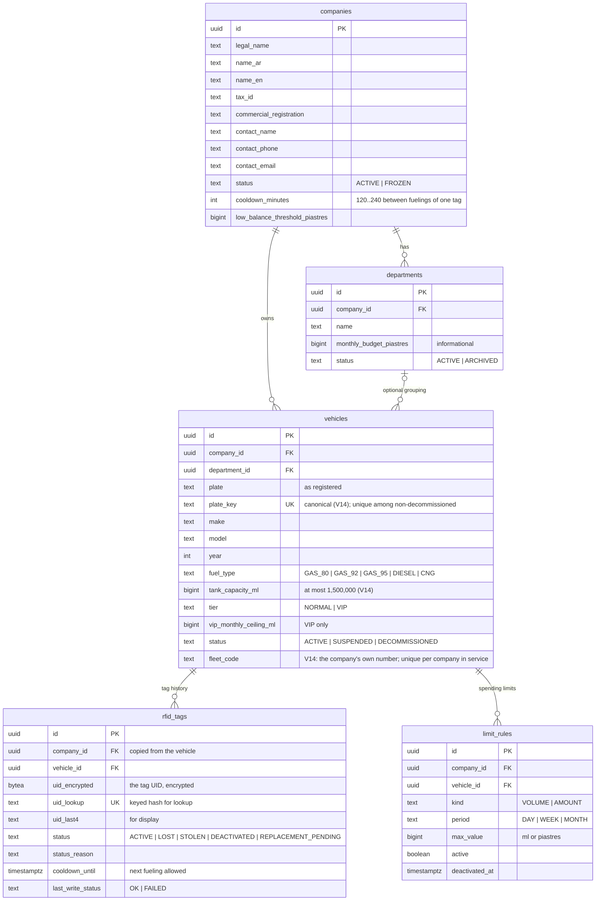

- **A company is the tenant.** Every fleet row carries `company_id`, and the trigger `vehicles_same_tenant` (with similar ones on tags and limits) refuses a row whose company disagrees with its parent's.
- **Tag UIDs are never stored in clear text.** `uid_lookup` is a keyed hash used to find the tag that was read, `uid_encrypted` is kept for Ops, and only `uid_last4` is ever shown. A tag reported `LOST` or `STOLEN` stops working on the next fueling.
- **Limits** are per vehicle. A fueling must fit every active rule. Changing a rule deactivates the old row and inserts a new one, so history is kept.
- **Cooldown** lives on the tag (`cooldown_until`), set by each completed fueling to *now + the company's cooldown*.
- **Identity never changes (V14, ADR 0023).** A trigger refuses any change to a tag's `company_id`, `vehicle_id` or UID columns, and to a vehicle's `company_id`, for every role. With the UID unique for ever, each `rfid_tags` row is one assignment and the table is the assignment history.
- **Plate key (V14).** For the Egyptian shape (one digit group, one letter group) the key puts the digits first, so `١٢٣٤ ط ب ع` and `ط ب ع 1234` are one plate; any other shape keeps its order, so two different plates never share a key. The migration stops if existing vehicles would collide.

---

## 6. Station network and devices (`V4`, `V7`, `V10`; module `network`)

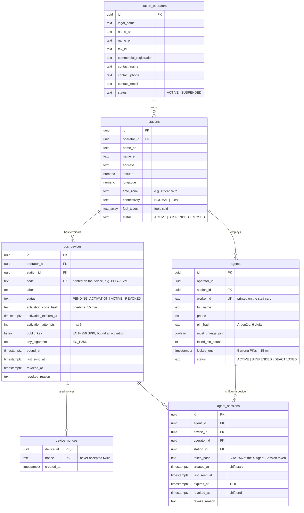

- **The operator is the station-side tenant.** Station managers are scoped to one operator and see all its stations.
- **A device proves itself with its key pair** (ADR 0010). Ops registers it and reads a one-time activation code to the installer. The device sends its public key once, then signs a challenge every 15 minutes to get a token. Used nonces are kept to stop replays.
- **An agent session is a shift.** One live session per agent. Since `V10` the station manager can read the operator's sessions; that is the "Shifts" view and the "last shift" filter.

---

## 7. Fuel prices (`V4`; module `pricing`)

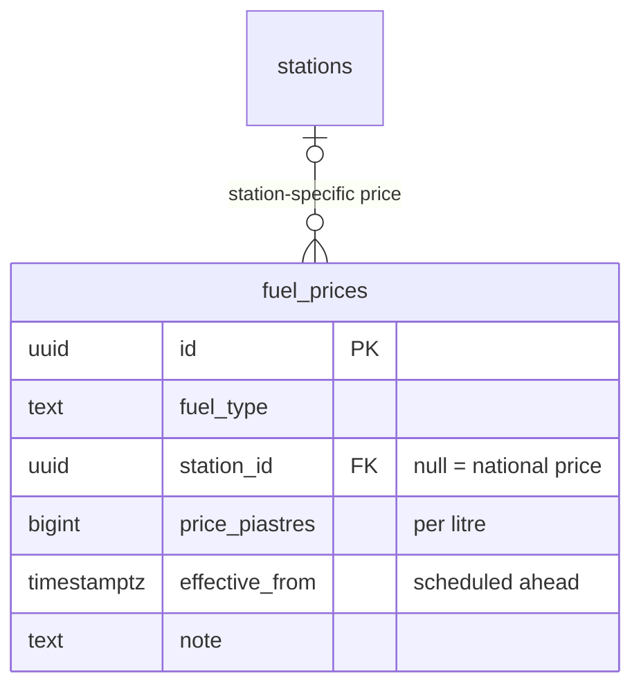

Prices are **effective-dated and append-only**. The price in force for a station and a fuel at instant *t* is the latest row with `effective_from <= t`. A station-specific row beats the national row (`station_id IS NULL`). Only Operations sets prices. Devices receive the current price and the next 7 days of changes in the offline snapshot.

---

## 8. Ledger, wallets and reconciliation (`V6`, `V6_1`, `V8`, `V9`; module `ledger`)

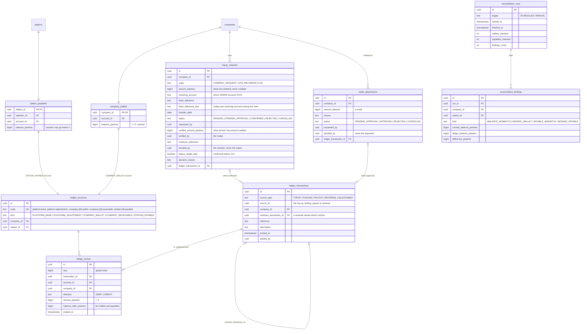

- **Double entry, immutable.** A transaction has two or more entries whose debits equal their credits (checked by a deferred trigger). Entries and transactions are never updated or deleted. A mistake is corrected with a **reversal**: a new transaction that names the original in `reverses_transaction_id`, with at most one reversal per transaction.
- **Cached balances.** `company_wallets.balance_piastres` and `station_payables.balance_piastres` change only under their row lock, in the same transaction as the entry, and the entry records `balance_after_piastres`. A wallet can never go below zero. A station payable can, when a fueling is reversed after the station was already paid.
- **Receivable:** when an offline fueling arrives and the wallet cannot cover it, the shortfall is debited to `company:{id}:receivable`. That is money the company owes; who settles it is an open owner decision.
- **Maker-checker (V12, ADR 0021).** A top-up is claimed (`PENDING`), verified by Operations with the amount that actually arrived (`PENDING_APPROVAL`), and approved by a different user holding `TOPUP_APPROVE` (`CONFIRMED`), which posts the verified amount, never the claimed one. Wallet adjustments (credits that are not bank transfers) follow the same rule and post against `platform:adjustments`. The two-person rule and "the verifier and decider are the acting user" are CHECK constraints and a guard trigger, not only service code.
- **Reconciliation** runs nightly (and on demand by Super Admin). It recomputes every wallet and payable from its entries and records any difference as a finding.

---

## 9. Fuelings, alerts and offline sync (`V7`, `V7_1`, `V8`, `V8_1`; module `fueling`, `sync`)

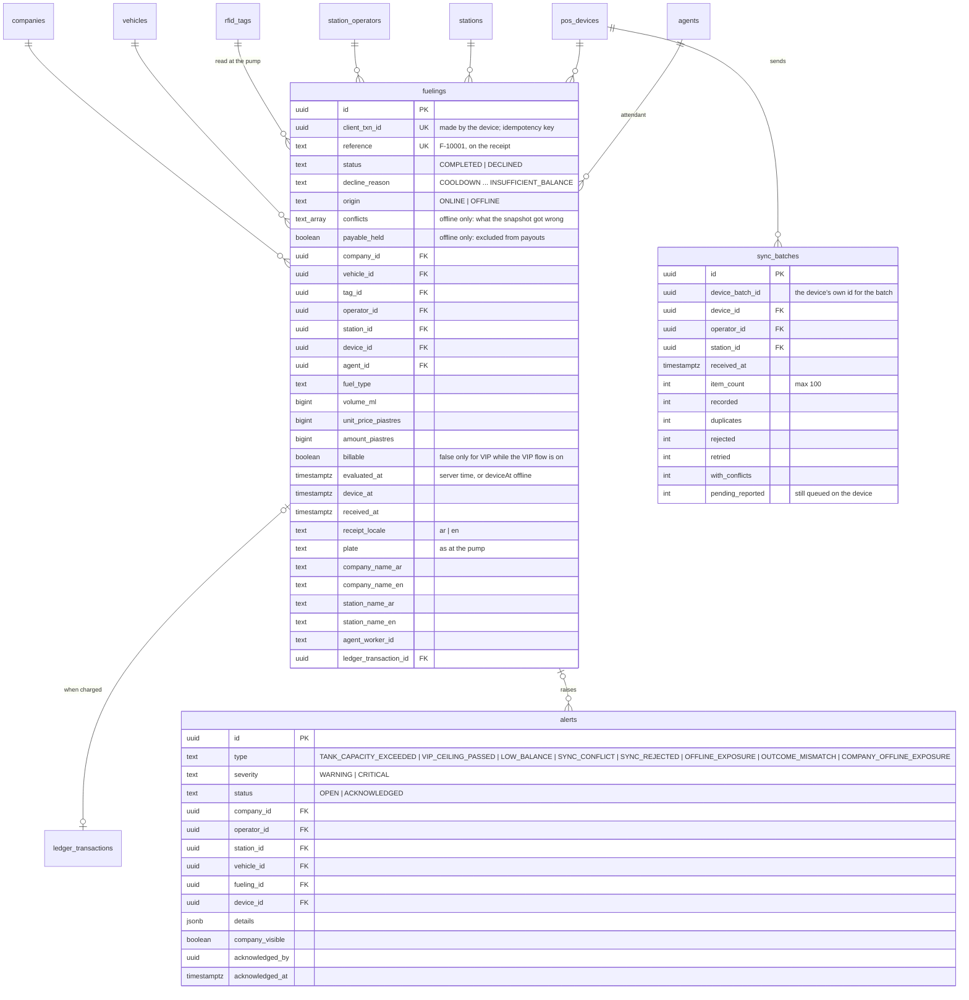

- **`fuelings` is the heart of the system and is immutable**: a trigger refuses `UPDATE`, `DELETE` and `TRUNCATE` for every role, including the owner (`V7_1`). Another trigger checks that the company, vehicle and tag agree with each other, and that the operator, station, device and agent agree with each other.
- **Declined fuelings are recorded too**, with `decline_reason`. Only a completed, billable fueling with an amount above zero has a ledger transaction (a CHECK).
- **Names are copied** (plate, company, station, agent worker ID) so each audience reads a fueling without seeing the other side's master data, and a later rename never rewrites a receipt.
- **Offline fuelings** (`origin = OFFLINE`) are always `COMPLETED`. Whatever the device's snapshot got wrong goes into `conflicts`, and the server raises a `SYNC_CONFLICT` alert. `payable_held` marks a payable kept back for Operations (`OVER_OFFLINE_ALLOWANCE`, `STATION_NOT_ACTIVE`). See `b5-sync-contract.md`.
- **Alerts** never block a fueling. `company_visible = false` hides an alert from the company (the VIP ceiling).

---

## 10. Station finance (`V9`; module `stationfinance`)

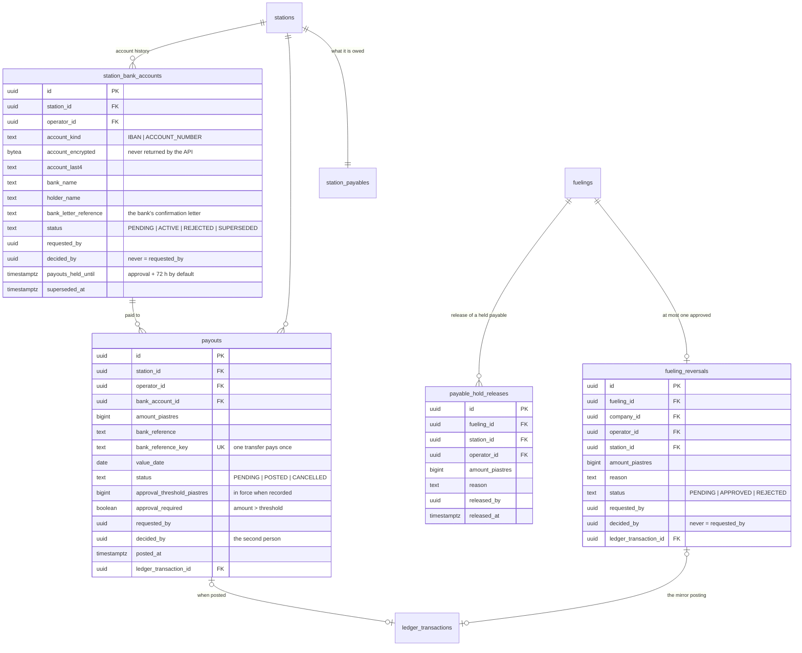

- **Position of a station:** *balance* (from `station_payables`), minus *held* (offline payables not yet released or reversed), gives *available*. A new payout may take at most *available − pending payouts*.
- **Dual control is enforced by the database, not only the API.** For each of a bank account change, a payout above the threshold (default 50,000 EGP, `zawed.finance.payout-approval-threshold-piastres`) and a reversal, a CHECK refuses a decision by the person who asked.
- **A new bank account receives nothing during a hold window** (`zawed.finance.bank-change-hold-hours`, default 72 h), so a fraudulent change can be noticed before money follows it.
- **A reversal** posts the exact mirror of the fueling's transaction: the wallet and receivable are refunded, and the station payable is debited.

---

## 11. Support tickets (`V11`; module `tickets`)

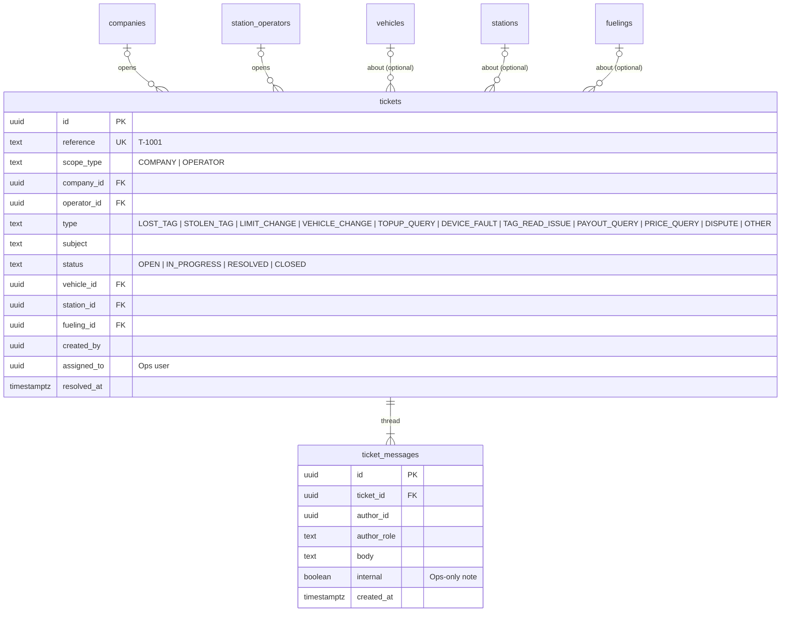

A ticket is a **request, not a change**: the company and station portals stay read-only for master data, and Operations makes the change. Each side sees only its own tickets. Internal notes are visible to Operations only (row-level security). Messages are append-only, and only Operations moves a ticket's status.

---

## 11b. Bulk vehicle import (`V15`; module `fleet`)

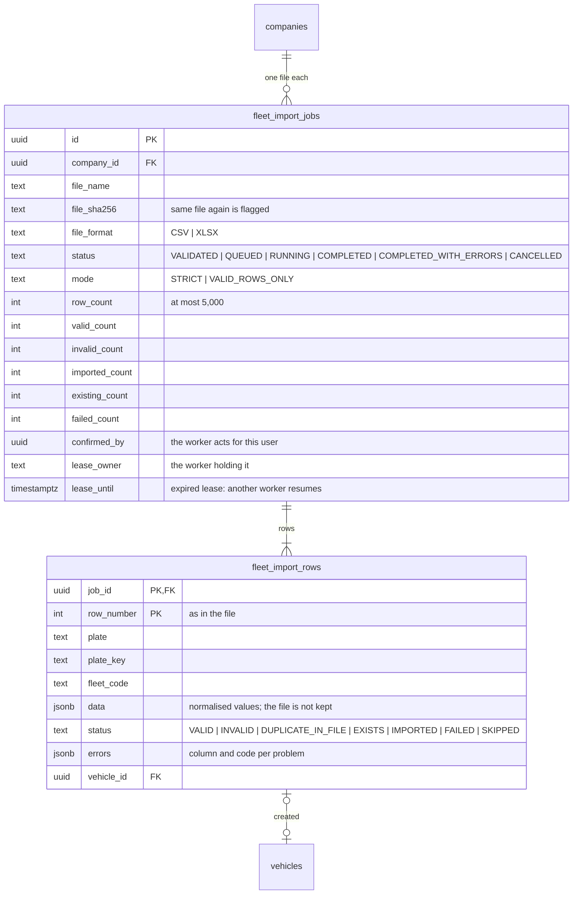

- **The upload creates nothing.** Every row is validated and stored first. `STRICT` (the default) confirms only a file without problems; `VALID_ROWS_ONLY` must be chosen explicitly.
- **One active import per company** (partial unique index on `QUEUED`/`RUNNING`).
- **The worker** (ADR 0026) claims a job with `FOR UPDATE SKIP LOCKED` and a lease. Each row's vehicle and outcome commit together, so a crash resumes at the first `VALID` row and nothing is created twice. The plate unique index is the last defence; a plate registered meanwhile makes the row `EXISTS`.
- **Platform only (RLS):** imports are an Operations action, never visible to the company.

---

## 12. Who can see what (row-level security)

Every request sets three session values (`app.scope_type`, `app.scope_id`, `app.user_id`), read by `app_scope_type()`, `app_scope_id()` and `app_is_platform()`. The policies below filter every query, so a bug in a service cannot leak another tenant's rows. The API also checks the scope, so a forbidden row answers 404.

| Table | Platform (Super Admin, Ops) | Company (Fleet Manager, Accountant) | Operator (Station Manager) |
|---|---|---|---|
| users | all | users of the same company | users of the same operator |
| companies, departments, vehicles, rfid_tags, limit_rules | all, write | own, read | — |
| station_operators, stations, pos_devices, agents | all, write | — | own, read |
| agent_sessions | all | — | own stations (V10) |
| fuel_prices | all, write | all, read | all, read |
| company_wallets, topup_requests, wallet entries | all | own (may withdraw only a `PENDING` request, V12) | — |
| station_payables, payable entries | all | — | own stations |
| fuelings | all | own (company_id) | own stations (operator_id) |
| sync_batches | all | — | own devices |
| alerts | all | own where `company_visible` | — |
| station_bank_accounts | all | — | own, `ACTIVE` and `PENDING` only |
| payouts | all | — | own, `POSTED` only |
| fueling_reversals | all | own, `APPROVED` only | own stations, `APPROVED` only |
| wallet_adjustments, fleet_import_jobs, fleet_import_rows | all | — | — |
| idempotency_keys | own keys only (every scope) | own keys only | own keys only |
| tickets / ticket_messages | all, with internal notes | own, without internal notes | own, without internal notes |
| audit_log | all (the API endpoint is Super Admin only) | rows of its own scope (no endpoint yet) | rows of its own scope (no endpoint yet) |

POS devices have no user. The device channel, fueling engine, offline sync and snapshot run explicitly in the platform scope (`DbScope.runAs`) after the device proof is checked. `ArchitectureTests` keeps the list of places allowed to do that closed.

---

## 13. How money moves (ledger postings)

| Event | Debit | Credit | Where |
|---|---|---|---|
| Top-up approved (the verified amount; V12) | `platform:bank` | `company:{id}:wallet` | `ledger.TopUps` |
| Wallet adjustment approved (V12) | `platform:adjustments` | `company:{id}:wallet` | `ledger.WalletAdjustments` |
| Fueling completed (online, or offline with enough balance) | `company:{id}:wallet` | `station:{id}:payable` | `fueling.FuelingEngine` |
| Offline fueling beyond the wallet | wallet (what it holds) + `company:{id}:receivable` (the rest) | `station:{id}:payable` (full amount) | `fueling.FuelingEngine` |
| Payout posted | `station:{id}:payable` | `platform:bank` | `stationfinance.Payouts` |
| Reversal approved | the mirror of the fueling: `station:{id}:payable` | wallet / receivable | `stationfinance.Reversals` |

Every posting goes through `ledger.Ledger`. It is the only writer of entries, takes locks in a fixed order (wallet → vehicle → tag for fuelings; payable after any wallet), and is checked by the nightly reconciliation.

---

## 14. Migration history

| Version | Phase | What it adds |
|---|---|---|
| V1 | B0 | Baseline and conventions |
| V2 | B1 | users, sessions, mfa_challenges, audit_log |
| V3 | B1 | Runtime role `zawed_app`, scope functions, RLS on identity, sign-in functions |
| V4 | B2 | Companies, fleet, operators, stations, devices, agents, prices, RLS, same-tenant triggers |
| V5 | B2 | RLS bound to the runtime role |
| V6, V6_1 | B3 | Ledger, wallets, top-ups, reconciliation; hardening |
| V7, V7_1 | B4 | Device keys and nonces, agent sessions, fuelings, alerts; fuelings immutable |
| V8, V8_1 | B5 | Offline: receivable account, conflicts, sync batches, held payables |
| V9 | B6 | Station payables, reversal links, bank accounts, payouts, hold releases, reversals; MFA for station managers |
| V10 | B6 | Station managers read their shifts |
| V11 | B6 | Support tickets |
| V12 | Hardening | Maker-checker top-ups (verified amount, receiving account, evidence), `OPS_MANAGER` role, wallet adjustments with `platform:adjustments`, guard triggers |
| V13 | Hardening | `idempotency_keys` |
| V14 | Hardening | Immutable tag and vehicle identity, tank ceiling, `fleet_code`, canonical plate keys, nonce purge function, company offline index and alert type |
| V15 | Hardening | Bulk vehicle import: `fleet_import_jobs`, `fleet_import_rows` |
| V16 | Hardening | Fueling time indexes: `(company_id, evaluated_at)`, `(operator_id, evaluated_at)`, BRIN `(evaluated_at)`, measured on 5 M rows |

To see the live schema, run the API locally (`apps/api/README.md`) and connect to the embedded database, or read the migrations in order.
