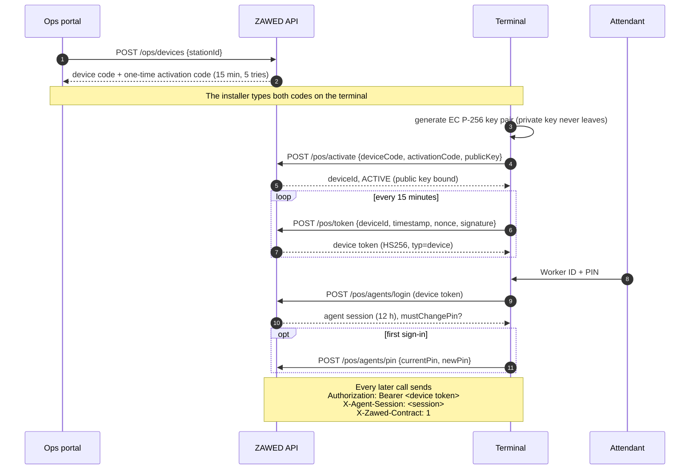
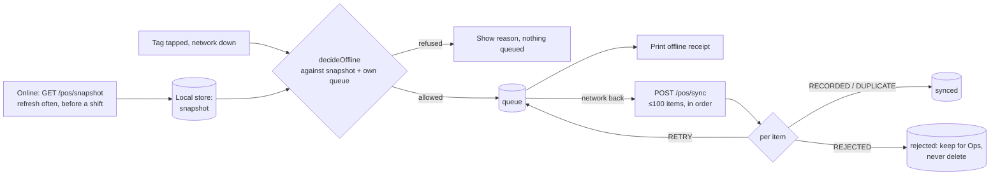
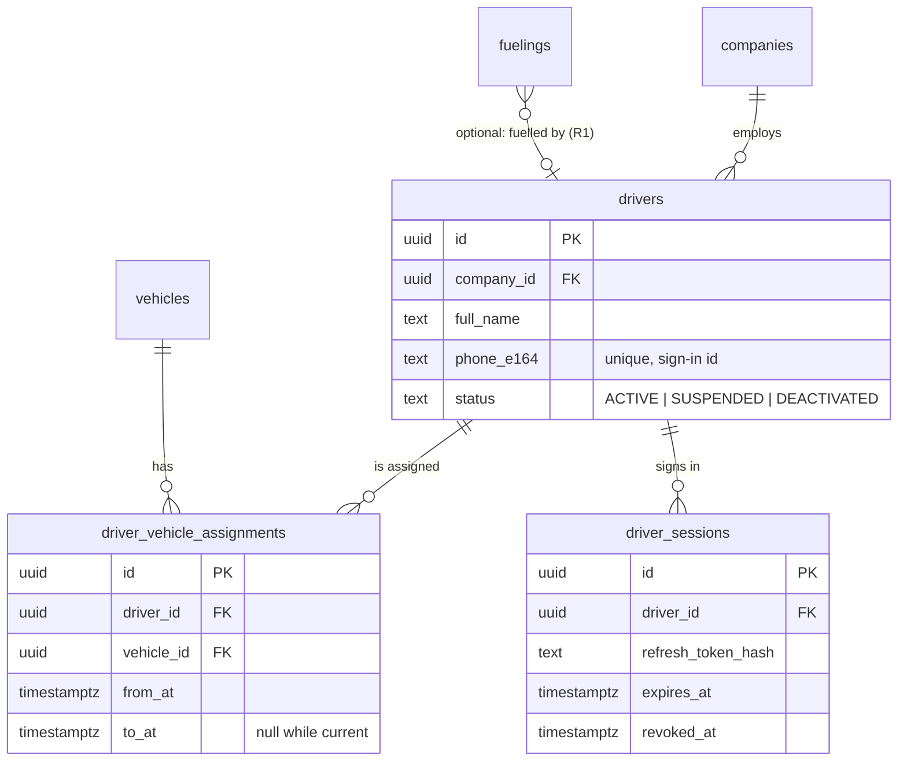

# The station terminal (POS) and a driver app

**Status:** 2026-11-19. The POS protocol is built, tested and live on `zawed-dev` (B4 online, B5 offline). The real Android terminal (B8) and the driver app are not built yet. This document explains the existing protocol to someone who will build a client on it, and proposes how a driver app fits the backend we already have.

**Read with:** `b4-fueling-contract.md` (device channel, the engine, receipts), `b5-sync-contract.md` (offline), ADR 0010 (device channel), ADR 0018 (fueling engine), ADR 0019 (offline protocol), `hardware-spike.md` (what the real device must prove). The live API reference is Swagger at `https://zawed-api-production.up.railway.app/api/v1/docs`, tag "pos".

---

## Part 1: the POS

### 1.1 What the POS is

The POS is an Android terminal at the pump, for example a Sunmi P2 with an NFC reader and a 58 mm thermal printer. The station attendant (an **agent**) uses it:

1. Read the RFID/NFC tag stuck on the vehicle's windscreen.
2. Enter the litres dispensed.
3. Get a decision from the server, or from the local snapshot when offline.
4. Print a receipt.

Rules that shape everything:

| Rule | Why |
|---|---|
| The device has **no user** and holds **no user token**. It proves itself with its own key pair; the agent proves themselves with a Worker ID and a 6-digit PIN. | A stolen terminal must not open any portal, and a portal token must not work on a pump route. |
| The agent never sees the company's balance, only a status word: `AVAILABLE`, `LOW`, `INSUFFICIENT`, `SUSPENDED`. | Company balances are confidential (PRD). |
| Every fueling carries a `clientTxnId` (UUID) generated **once**, before the first send. | Resending is always safe (idempotency): a lost answer never causes a double charge. |
| The server is the judge. The device decides offline only to keep the pump moving, and the server records every offline fueling and flags whatever the device got wrong. | PRD §7.5: never reverse an offline fueling against the driver or the agent. |

### 1.2 What exists today

| Piece | Where | State |
|---|---|---|
| Server side of the protocol | `apps/api`: modules `network` (devices, agents, sessions), `fueling` (engine, receipts, offline sync), `sync` (snapshot, sync monitor), `rules` (pure decision logic) | Done, tested, deployed |
| **Web POS on the real API** (the protocol's reference client) | `apps/web/src/pos/live/` | Done. Runs in the browser at `/pos` when `VITE_API_MODE=http` |
| Demo POS on mock data | `apps/web/src/pos/*.tsx` (outside `live/`) | Investor demo only; do not build on it |
| Real Android app (Kotlin) | `apps/pos/` (planned) | **Not started.** Waits for the hardware spike and two ADRs (tag model, framework) |

The web POS is the best specification of a client: it does everything the Kotlin app must do, against the same endpoints.

| File | What it does |
|---|---|
| `pos/live/device-key.ts` | Generates the device's EC P-256 key pair (WebCrypto, non-extractable) and keeps it in IndexedDB; signs the token challenge |
| `pos/live/pos-api.ts` | Every POS call: activate, token (auto-refreshed), agent sign-in, PIN change, sign-out, record fueling, snapshot, sync batch, resolve. Sends `X-Zawed-Contract` |
| `pos/live/offline.ts` | Pure offline logic: UID normalising, tag digest, price at a time, limit periods (Saturday weeks, station time zone), `decideOffline` (the same check order as the server) |
| `pos/live/offline-store.ts` | IndexedDB stores: `snapshot`, `queue` (unsent captures), `synced`, `rejected`, `attempts` (online attempts saved before sending) |
| `pos/live/use-offline.ts` | When to refresh the snapshot, flush the queue and resolve lost answers |
| `pos/live/LivePos.tsx` | The screens: activate → agent sign-in → change PIN → tag → volume → result/receipt, plus the offline screens and the sync panel |
| `pos/live/LiveReceiptPage.tsx` | The public receipt page behind `receiptPath` |

### 1.3 Life of a terminal



**Token signature.** The terminal signs exactly this text with ECDSA P-256 / SHA-256:

```
zawed-device-token\n{deviceId}\n{timestamp}\n{nonce}
```

The timestamp is in epoch seconds and must be within ±5 minutes of server time; if not, the answer is `DEVICE_CLOCK_SKEW` with `params.serverTime`. The nonce is 16–128 characters and never reused. The signature goes in base64; the web client sends it in DER form.

**What revokes what.** Revoking the device, suspending its operator or station, suspending the agent, or a PIN reset by Ops takes effect on the **next request**. The server re-reads the device and the session every time. One agent has one live session: signing in on another terminal ends the first.

### 1.4 One fueling, online

```mermaid
sequenceDiagram
    autonumber
    participant Agent
    participant POS
    participant API
    participant DB as PostgreSQL

    Agent->>POS: tap tag, enter litres
    POS->>POS: clientTxnId = new UUID; save the attempt locally
    POS->>API: POST /pos/fuelings {clientTxnId, tagUid, volumeMl, fuelType?, deviceAt, receiptLocale}
    API->>DB: lock wallet → vehicle (share) → tag
    API->>API: rules: cooldown, tag, vehicle, company, fuel, price, limits, balance
    alt allowed
        API->>DB: ledger: wallet → station payable; insert fueling; start cooldown; alerts
        API-->>POS: 201 COMPLETED, reference F-10001, amount, receiptPath, walletStatus
    else refused
        API->>DB: insert fueling (DECLINED, reason)
        API-->>POS: 201 DECLINED, declineReason
    end
    POS->>Agent: result + print receipt
```

- The decision order is fixed. The first failing check is the reason: `COOLDOWN`, `TAG_INACTIVE`, `VEHICLE_INACTIVE`, `COMPANY_FROZEN`, `FUEL_TYPE_MISMATCH`, `FUEL_NOT_AVAILABLE`, `LIMIT_EXCEEDED`, `INSUFFICIENT_BALANCE`.
- **Resend the same `clientTxnId`** after a timeout. The answer is `200 replayed: true` with the stored outcome.
- **Lost answer, then the agent refused the driver:** call `POST /pos/fuelings/{clientTxnId}/resolve {toldOutcome:"REFUSED"}`. If the server had completed it, an `OUTCOME_MISMATCH` alert reaches Ops and the company.
- **Receipt:** `receiptPath` is a signed public link (`/api/v1/receipts/{id}?sig=…`) that never expires. Print it as a QR code so the driver keeps proof of purchase.
- **Amounts** are integer piastres and volumes integer millilitres. Never use floating point.

### 1.5 Offline



**What the snapshot carries:** the station, its prices (now and the next 7 days), a per-device `tagKey`, tag digests (32-bit HMAC of the UID, never the UID), vehicles, limits as *remaining* amounts, and per company a wallet status word plus an offline allowance (`min(balance, 5,000 EGP)`, rounded down to 100 EGP). It never carries UIDs, balances or PIN hashes.

**Rules the client must apply:**
- A snapshot older than 24 hours, or a station that is not open, decides nothing: refuse offline.
- Apply your own queued captures on top of the snapshot: lower the allowance and the limits, and set the tag's cooldown.
- Keep the offset between the device clock and `serverTime`, and use server time.
- Offline sign-in is not possible. Only an agent already signed in online keeps working until the 12-hour session ends.
- Tags with a 4-byte UID are not in the snapshot: they are decided online only.

**What the server does with a batch:** it records every capture for a known tag as `COMPLETED`, even when a check fails. Each failed check goes into `conflicts`, and the server raises a `SYNC_CONFLICT` alert. The station is always paid in full. If the wallet cannot cover the amount, the shortfall goes to the company's receivable account. Past 10,000 EGP of offline fuel per device and company in 24 hours, the payable is held and a critical `OFFLINE_EXPOSURE` alert is raised.

### 1.6 Endpoint list

| Call | Auth | Notes |
|---|---|---|
| `POST /pos/activate` | none (one-time code) | Once per device |
| `POST /pos/token` | signed challenge | Every ≤15 min |
| `POST /pos/agents/login` | device | Worker ID + PIN |
| `POST /pos/agents/pin` | device + session | Forced on first sign-in |
| `POST /pos/agents/logout` | device + session | |
| `POST /pos/fuelings` | device + session | Online fueling |
| `POST /pos/fuelings/{clientTxnId}/resolve` | device + session | Lost answer |
| `GET /pos/snapshot` | device | Offline data |
| `POST /pos/sync` | device | Offline batch (no agent needed) |
| `GET /receipts/{id}?sig=` | public | Receipt |
| `GET /meta` | public | `posContract`, `posContractMinimum` |

Client-side error handling:

| Code | Client action |
|---|---|
| `DEVICE_UNAUTHENTICATED` | Get a new token. If that fails too, the device was revoked: go back to activation |
| `DEVICE_CLOCK_SKEW` | Use `params.serverTime`, keep the offset, retry |
| `AGENT_SESSION_INVALID`, `AGENT_SESSION_REQUIRED` | Back to agent sign-in |
| `PIN_CHANGE_REQUIRED` | Show the PIN change screen |
| `AGENT_LOCKED` | Show `params.retryAfterSeconds` |
| `CONTRACT_UPGRADE_REQUIRED` (426) | Block and ask for an app update |
| `TAG_NOT_RECOGNISED`, `STATION_NOT_ACTIVE`, `INVALID_VOLUME` | Show; nothing was recorded |
| Network error or 5xx on a fueling | Resend with the **same** `clientTxnId`; if still down, decide offline |

### 1.7 Building the real Kotlin POS (B8)

What the Android app must add on top of what the web client does:

1. **Hardware spike first** (`hardware-spike.md`): NFC read time (p95 ≤ 300 ms), which secure tag (NTAG 424 DNA or DESFire EV3, to stop cloned UIDs), Arabic thermal printing, kiosk mode, 4G, clock.
2. **Keys** in Android Keystore, hardware-backed and non-exportable. Use the same EC P-256 scheme; the server does not change.
3. **Persistent queue** in an encrypted local database (Room + SQLCipher, or the platform's encrypted storage). The queue must survive reboots and an empty battery. Never delete rejected items.
4. **Shared rules:** the server's decision logic is in the framework-free Java module `rules` (`apps/api/src/main/java/com/zawed/api/rules`). Kotlin can use that code directly, so the offline decision cannot drift from the server's. The web port in `offline.ts` and its tests (`offline.test.ts`) are the test vectors.
5. **Contract header:** send `X-Zawed-Contract: 1`, and handle 426.
6. **Later (owner decisions pending):** offline PIN verification with secure hardware, writing the cooldown onto the secure tag, plate OCR, and evidence photos.

---

## Part 2: a driver app (proposal, not built)

### 2.1 Where it stands in the plan

The roadmap puts the driver app outside the pilot and puts a **thin driver PWA** in V1.5 (`competitive-analysis/zawed-roadmap-delta.md` §5, §7). Driver identity per fueling (R1) is a research item. Today the system knows the **vehicle** (through its tag) and the **agent**, but not the driver, and no table or role for drivers exists. Everything below is a proposal that fits the current backend. Nothing in it is decided.

### 2.2 What a driver would get

| Feature | Backed by what exists | New work |
|---|---|---|
| My vehicle(s): plate, fuel type, status | `vehicles` | Assignment of drivers to vehicles |
| What I may still fuel today, this week and this month | The engine's limit calculation (the snapshot already computes `remaining` per period) | A driver read endpoint |
| When I may fuel again (cooldown) | `rfid_tags.cooldown_until` | Endpoint |
| My fuelings and receipts | `fuelings`, signed `receiptPath` | Filter by the driver's vehicles |
| Nearby stations that sell my fuel, with today's price | `stations` (lat/long, `fuel_types`), `fuel_prices` | Map screen |
| Report a lost or damaged tag | Tickets (`LOST_TAG`, B6) | Let a driver open a ticket for the company |
| "You were just fuelled 20 L at station X" | Fueling insert | Push notifications (PRD Phase 2 "transaction validation") |
| Odometer reading at each fueling | Nothing yet (roadmap M2) | A column and an optional photo |

What a driver must **never** see: the company's wallet balance, other vehicles, or other drivers. The same rule applies on the POS.

### 2.3 How it would fit the backend



- **Who manages drivers:** Ops at first, the same as vehicles and tags (company portals stay read-only in the pilot). The fleet manager would ask through a ticket.
- **Sign-in:** a phone number with a one-time SMS code (needs an SMS provider; owner decision), or an invitation link sent by the company. Drivers are not portal users: use a separate `/api/v1/driver/**` security chain with its own token type, as the POS has (ADR 0010 pattern), so a driver token never opens a portal.
- **Tenant isolation:** add a `DRIVER` scope to the database context (`app_scope_type() = 'DRIVER'`, `app_scope_id() = driver id`). Then add RLS policies so a driver reads only the vehicles currently assigned, their fuelings and their tags' cooldown. Follow the existing pattern in `V3__runtime_role_and_rls.sql` and `V4__master_data.sql`, and extend `RowLevelSecurityTests` and `AuthorizationMatrixTests`.
- **Endpoints (sketch):**

| Endpoint | Returns |
|---|---|
| `POST /driver/auth/otp`, `POST /driver/auth/verify`, `POST /driver/auth/refresh` | Sign-in |
| `GET /driver/me` | Profile and assigned vehicles |
| `GET /driver/vehicles/{id}/allowance` | Remaining per limit period and cooldown, never the balance |
| `GET /driver/fuelings` | Their vehicles' fuelings with receipt links |
| `GET /driver/stations?near=lat,lng&fuel=` | Stations and current prices |
| `POST /driver/tickets` | Lost tag, problem at a station |

- **Driver identity at the pump (R1, later):** one option is a short-lived, signed QR code shown in the app that the POS scans next to the tag; the server then stores `fuelings.driver_id`. The tag stays the payment credential; the QR only says who was driving. That needs a POS contract version 2 and is not a pilot item.
- **Technology:** start as a PWA inside `apps/web` (a new `driver` portal), reusing the design system, both languages and the existing API client. A native app (Kotlin or React Native) is worth it only when push notifications or background location become requirements.

### 2.4 Order of work if it is approved

1. Owner decisions: sign-in method (SMS provider), who manages drivers, and whether the driver is recorded per fueling.
2. Migration: `drivers`, `driver_vehicle_assignments`, `driver_sessions`, the `DRIVER` scope and RLS. Send the migration and the security chain to `zawed-deep` (Fable): it is authentication plus tenant isolation.
3. Read endpoints, matrix rows, tests.
4. PWA screens: sign-in, my vehicle, allowance, history, receipts, stations, report a problem.
5. Push notifications (V1.5) and the QR identity (with POS contract 2).
